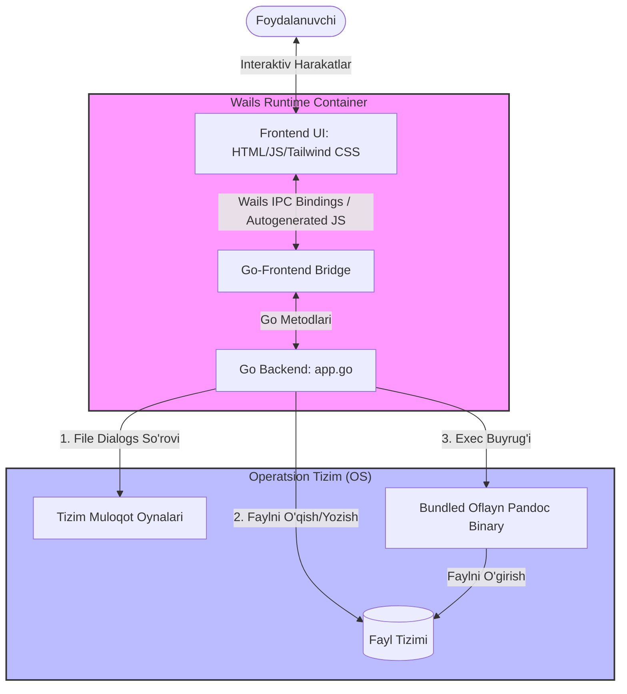

# Pandoc Pro — Batafsil Hujjatlar va Qo'llanma (Documentation)

Ushbu hujjat **Pandoc Pro** loyihasining me'morchiligi, texnik tuzilishi, ishlab chiqish (development) muhiti, o'rnatish qo'llanmasi va tizim funksiyalarini batafsil tushuntiradi.

---

## 🗺️ Mundarija
1. [Loyiha haqida (Overview)](#-loyiha-haqida-overview)
2. [Tizim Arxitekturasi (System Architecture)](#-tizim-arxitekturasi-system-architecture)
3. [Texnologik Stek (Tech Stack)](#-texnologik-stek-tech-stack)
4. [Loyiha Tuzilishi (Project Directory Structure)](#-loyiha-tuzilishi-project-directory-structure)
5. [Backend API Hujjatlari (Go)](#-backend-api-hujjatlari-go)
6. [Frontend Arxitekturasi (HTML/JS/CSS)](#-frontend-arxitekturasi-htmljscss)
7. [CI/CD va Avtomatlashtirilgan Yig'ish (GitHub Actions)](#-cicd-va-avtomatlashtirilgan-yigish-github-actions)
8. [Muammolarni Bartaraf Etish (Troubleshooting)](#-muammolarni-bartaraf-etish-troubleshooting)

---

## 🚀 Loyiha haqida (Overview)

**Pandoc Pro** — bu hujjatlarni oflayn rejimda bir formatdan boshqasiga oson va professional darajada o'giruvchi (convert qiluvchi) cross-platform desktop ilova. 

Ilovaning asosiy maqsadi — foydalanuvchiga murakkab buyruqlar satri (CLI) bilan ishlovchi **Pandoc** konverterini vizual, chiroyli va qulay interfeys (GUI) orqali taqdim etishdir. Eng muhimi, u butunlay **oflayn (internet talab qilmaydigan)** ishlaydi, chunki har bir platforma uchun mos keladigan Pandoc ekzekutiv binary fayli o'rnatish paketi ichiga oldindan joylashtiriladi (bundled).

---

## 📐 Tizim Arxitekturasi (System Architecture)

Loyiha **Wails v2** freymvorki asosida qurilgan. Wails ilovani Go backend va veb-texnologiyalardan tashkil topgan frontend qismlariga ajratadi. Ular bir-biri bilan xavfsiz va tezkor IPC (Inter-Process Communication) kanali orqali bog'lanadi.

Quyidagi diagrammada tizim qismlarining o'zaro ishlash sxemasi ko'rsatilgan:



### Arxitekturaning asosiy tamoyillari:
1. **Frontend-heavy UI**: Foydalanuvchi interfeysi silliq animatsiyalar va o'tishlar bilan to'liq client-side render qilinadi.
2. **Strict File Security**: Mahalliy fayllarga faqat foydalanuvchi muloqot oynasi (file dialog) orqali ruxsat bergandan keyin Go backend yordamida murojaat qilinadi.
3. **Oflayn Pandoc Exec**: Go backend konvertatsiya jarayonida tashqi API yoki internetga ulanmaydi. Buning o'rniga u operatsion tizimda alohida jarayon (subprocess) sifatida oflayn `pandoc` dasturini ishga tushiradi.

---

## 🛠️ Texnologik Stek (Tech Stack)

* **Backend (Core Logic)**: Go (golang) `1.23+`
* **Desktop Application Wrapper**: Wails `v2.12.0` (Mahalliy WebKit dvigatelidan foydalanadi: Windows-da WebView2, macOS-da WebKit, Linux-da WebKit2Gtk).
* **Frontend (UI Layer)**: HTML5, Vanilla JavaScript (ES6+), Tailwind CSS (vizual uslublar uchun CDN yordamida bog'langan).
* **Installer (Windows)**: NSIS (Nullsoft Scriptable Install System) `3.12+`
* **CI/CD (Cross-Platform compilation)**: GitHub Actions.

---

## 📂 Loyiha Tuzilishi (Project Directory Structure)

```text
pandoc-convert/
├── .github/
│   └── workflows/
│       └── build.yml       # GitHub Actions CI/CD yig'ish ssenariysi
├── build/                  # Yig'ilgan desktop fayllar va piktogrammalar
│   ├── bin/                # Mahalliy build qilingan .exe yoki installer fayllar joylashadigan joy
│   ├── appicon.png         # Ilova belgisi
│   └── windows/            # Windows uchun maxsus manifest va resurslar
├── frontend/               # UI va mijoz qismidagi kodlar (Web-stack)
│   ├── dist/               # Yig'ilgan tayyor statik fayllar (Wails buni o'qiydi)
│   ├── src/                # CSS/JS va asosiy resurslar
│   ├── index.html          # Asosiy HTML sahifa (barcha mantiq, i18n va dizayn shu yerda)
│   ├── wailsjs/            # Go metodlari uchun avtomatik yaratilgan JS bog'lamalari
│   └── package.json        # Frontend kutubxonalari va scriptlari
├── app.go                  # Go Backend: Ilovaning asosiy mantig'i va metodlari
├── main.go                 # Ilovani ishga tushirish (Wails sozlamalari)
├── go.mod / go.sum         # Go dependencylari va modullari
├── installer.nsi           # Windows uchun NSIS oflayn o'rnatuvchi skripti
├── README.md               # Loyihani qisqacha ishga tushirish yo'riqnomasi
└── DOCUMENTATION.md        # Batafsil hujjatlar (Ushbu fayl)
```

---

## ⚙️ Backend API Hujjatlari (Go)

[app.go](file:///C:/Users/Cyber/pandoc-convert/app.go) faylida e'lon qilingan `App` strukturasidagi metodlar frontend qismiga eksport qilinadi. Quyida ushbu metodlarning prototipi va vazifalari keltirilgan:

### 1. `CheckPandoc() string`
Dastur joylashgan papkada yoki tizimda Pandoc o'rnatilganligini tekshiradi.
* **Qaytaradigan qiymat**: 
  - `"ready"` — Pandoc topildi va ishga tayyor.
  - `"missing"` — Pandoc topilmadi.

### 2. `SelectInputFile() string`
Foydalanuvchiga kirish faylini tanlash uchun tizim muloqot oynasini (Open File Dialog) ochadi.
* **Qaytaradigan qiymat**: Tanlangan faylning to'liq mutlaq yo'li (agar tanlanmasa bo'sh satr `""`).

### 3. `SelectOutputFile(ext string) string`
Foydalanuvchiga chiqish faylini qayerda va qanday nom bilan saqlashni tanlash uchun tizim muloqot oynasini (Save File Dialog) ochadi.
* **Parametr**: `ext` (string) — Chiqish fayli kengaytmasi (masalan, `.pdf`, `.docx`).
* **Qaytaradigan qiymat**: Saqlanishi kerak bo'lgan faylning mutlaq yo'li (agar rad etilsa bo'sh satr `""`).

### 4. `GetFileInfo(path string) (map[string]interface{}, error)`
Tanlangan kirish fayli haqidagi batafsil ma'lumotlarni qaytaradi (hajmi va dastlabki matnli qismi).
* **Parametr**: `path` (string) — Fayl yo'li.
* **Qaytaradigan qiymat**:
  ```go
  map[string]interface{}{
      "size": int64,         // Baytlardagi hajmi
      "preview": string,     // Matnli fayllardan dastlabki 600 ta belgi (yoki rasm bo'lsa "")
  }
  ```

### 5. `ConvertFile(inputPath string, outputPath string) string`
Eng asosiy metod. Berilgan kirish faylini Pandoc orqali kerakli formatga o'giradi.
* **Parametrlar**:
  - `inputPath` (string) — Kirish fayli mutlaq yo'li.
  - `outputPath` (string) — Chiqish fayli mutlaq yo'li.
* **Qaytaradigan qiymat**: 
  - `"success"` — Muvaffaqiyatli yakunlansa.
  - `Error message` (string) — Agar xatolik yuz bersa, terminaldagi xato matni (exit status, stdErr).

### 6. `OpenFile(path string) error`
Konvertatsiya qilingan faylni tizimdagi standart ko'rish dasturi orqali ochadi (masalan, `.pdf` ni Acrobat Reader-da, `.docx` ni MS Word-da).
* **Parametr**: `path` (string) — Fayl yo'li.

### 7. `RevealInExplorer(path string) error`
Belgilangan fayl joylashgan papkani tizim fayl menejerida (Explorer/Finder) ochadi va ushbu faylni belgilangan (selected) holatda ko'rsatadi.
* **Parametr**: `path` (string) — Fayl yo'li.

---

## 🎨 Frontend Arxitekturasi (HTML/JS/CSS)

Frontend [frontend/index.html](file:///C:/Users/Cyber/pandoc-convert/frontend/index.html) faylida yagona sahifa (Single Page Application) ko'rinishida qurilgan. U Tailwind CSS stilizatsiyasi bilan premium ko'rinishga keltirilgan.

### 1. Ko'p Tilli Tizim (i18n)
Dastur **O'zbekcha (UZ)**, **Ruscha (RU)** va **Inglizcha (EN)** tillarini qo'llab-quvvatlaydi. 
* Tarjimalar global `translations` ob'ektida saqlanadi.
* HTML elementlarida dynamic tarjima qilinishi kerak bo'lgan qismlarga `data-i18n="KEY"` atributi qo'shilgan.
* `setLanguage(lang)` funksiyasi chaqirilganda:
  1. `appState.language = lang` qiymati yangilanadi va `localStorage`ga yoziladi.
  2. `document.querySelectorAll('[data-i18n]')` elementlarining `innerText` qiymati mos tilga yangilanadi.
  3. Dynamic interfeys qismlari (fayl kartasi, yuklash tugmasi holati, xabarlar oynasi va tarix) qaytadan render qilinadi.

### 2. Mavzularni Boshqarish (Theme Switcher)
Dasturda tungi rejim (Dark Mode) va yorug' rejim (Light Mode) mavjud.
* Tanlangan mavzu `html` tegining `class` ro'yxatiga `dark` klassini qo'shish yoki olib tashlash orqali boshqariladi.
* Mavzu holati `localStorage`da saqlanadi, shuning uchun dastur keyingi safar ochilganda foydalanuvchining oxirgi tanlovi eslab qolinadi.

### 3. Drag & Drop Tizimi
Foydalanuvchi faylni dastur oynasiga sudrab kelganda, `dropZone` elementi vizual o'zgaradi (faollashadi). Drop hodisasi sodir bo'lganda, JavaScript fayl yo'lini o'qiydi va Go backend orqali fayl ma'lumotlarini yuklaydi.

---

## 🚀 CI/CD va Avtomatlashtirilgan Yig'ish (GitHub Actions)

Loyiha uchun parallel ravishda uchta operatsion tizimda dasturlarni avtomatlashtirilgan tarzda yig'ish yo'lga qo'yilgan. Konfiguratsiya [.github/workflows/build.yml](file:///C:/Users/Cyber/pandoc-convert/.github/workflows/build.yml) faylida yozilgan.

### Platformalararo oflayn paketlarni yaratish mantig'i:

```mermaid
flowchart TD
    Push[Git Push to Main] --> Trigger[GitHub Actions Trigger]
    
    subgraph Windows Build Runner
        WinRun[windows-latest] --> WinBuild[wails build -nopackage]
        WinBuild --> WinDL[Download Pandoc Windows zip]
        WinDL --> WinBundle[Copy pandoc.exe to build/bin/]
        WinBundle --> NSIS[Run makensis installer.nsi]
        NSIS --> WinArtifact[Upload pandoc-pro-installer.exe]
    end
    
    subgraph macOS Build Runner
        MacRun[macos-latest] --> MacBuild[wails build]
        MacBuild --> MacDL[Download Pandoc macOS arm64 zip]
        MacDL --> MacBundle[Copy pandoc to App Contents/MacOS/]
        MacBundle --> MacZip[Zip pandoc-app.app]
        MacZip --> MacArtifact[Upload pandoc-pro-mac.zip]
    end

    subgraph Linux Build Runner
        LinRun[ubuntu-latest] --> LinDeps[Install webkit2gtk-4.1]
        LinDeps --> LinBuild[wails build -tags webkit2_41]
        LinBuild --> LinDL[Download Pandoc Linux tar.gz]
        LinDL --> LinBundle[Extract & Copy pandoc to build/bin/]
        LinBundle --> LinTar[Create tar.gz with app & pandoc]
        LinTar --> LinArtifact[Upload pandoc-pro-linux.tar.gz]
    end
```



### Yig'ilgan oflayn fayllar tarkibi:
* **Windows**: `pandoc-pro-installer.exe` (NSIS yordamida yaratilgan o'rnatuvchi dastur. U o'z ichiga Wails ilovasi `.exe` faylini va `pandoc.exe`ni oladi va ularni `Program Files`ga o'rnatadi).
* **macOS**: `pandoc-pro-mac.zip` (Tarkibida `pandoc-app.app` ilovasi bor. Portable `pandoc` binary fayli dasturning ichki paketidagi `Contents/MacOS/` papkasiga joylangan, shuning uchun u to'liq oflayn va mustaqil ishlaydi).
* **Linux**: `pandoc-pro-linux.tar.gz` (Ichida `pandoc-app` va `pandoc` ekzekutiv binary fayllari mavjud. Ikkala fayl ham bir xil papkada joylashgan holda ishga tushishi shart).

---

## 🔍 Muammolarni Bartaraf Etish (Troubleshooting)

### 1. Windows: "Cannot read properties of null (reading 'classList')"
* **Muammo**: Tarixni tozalash paytida tarix ro'yxatining bo'sh ekanligini bildiruvchi matn topilmay xatolik beradi.
* **Yechim**: HTML tarkibidagi `emptyHistoryText` elementi tarix ro'yxati konteyneridan tashqariga olindi va muammo bartaraf etildi.

### 2. macOS: "pandoc-app.app is damaged and cannot be opened"
* **Sababi**: macOS internetdan yuklab olingan va rasmiy Apple sertifikati bilan imzolanmagan dasturlarga avtomat ravishda "karantin" bayrog'ini qo'yadi.
* **Yechim**: Terminalni ochib, dastur o'rnatilgan yo'l uchun quyidagi buyruqni bering:
  ```bash
  xattr -cr /Applications/pandoc-app.app
  ```

### 3. Linux: "WebKit2Gtk library not found"
* **Sababi**: Ubuntu 24.04+ kabi yangi tizimlarda eski `webkit2gtk-4.0` kutubxonasi olib tashlangan va o'rniga `4.1` versiyasi ishlatiladi.
* **Yechim**: Kompilyatsiya vaqtida `webkit2_41` tagidan foydalanib yig'ish kerak:
  ```bash
  wails build -tags webkit2_41
  ```
  Tizimga o'rnatish buyrug'i:
  ```bash
  sudo apt install libgtk-3-dev libwebkit2gtk-4.1-dev build-essential pkg-config
  ```

### 4. Pandoc: "Unusual conversion: to convert a .tex file to PDF..."
* **Sababi**: Pandoc `.tex` (LaTeX) fayllarini to'g'ridan-to'g'ri PDF formatiga o'gira olmaydi, unga qo'shimcha ravishda kompyuterda `pdflatex` (yoki `xelatex`/`lualatex`) o'rnatilgan bo'lishi talab etiladi.
* **Yechim**: Ilovada LaTeX fayllarini PDFga o'girishdan oldin tizimda LaTeX tarqatuvchisi (masalan, MiKTeX yoki TeX Live) o'rnatilganligini tekshiring yoki LaTeX fayllarini avval `.docx` yoki `.html` formatlariga o'giring.
